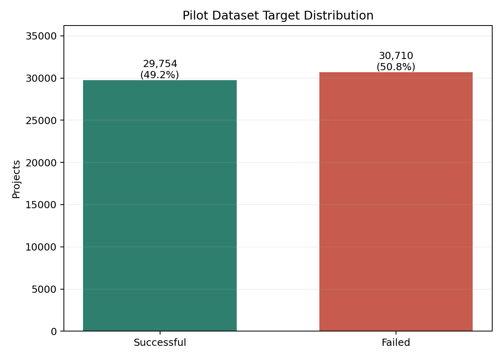
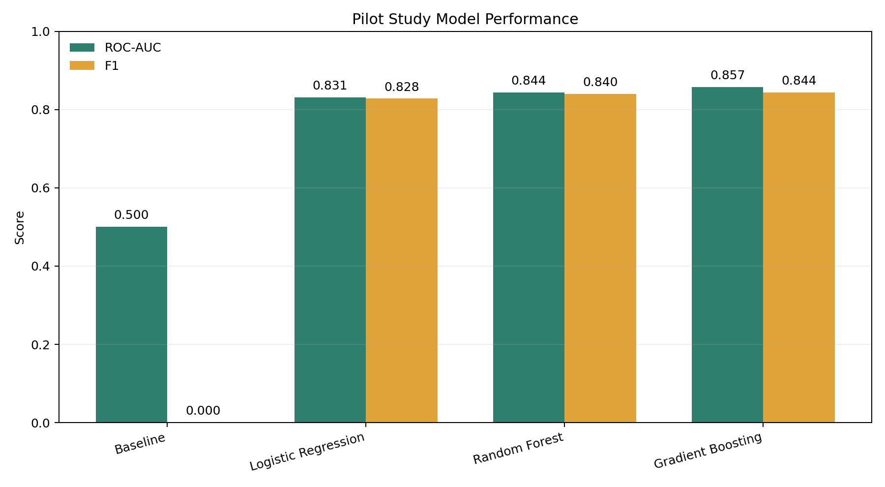
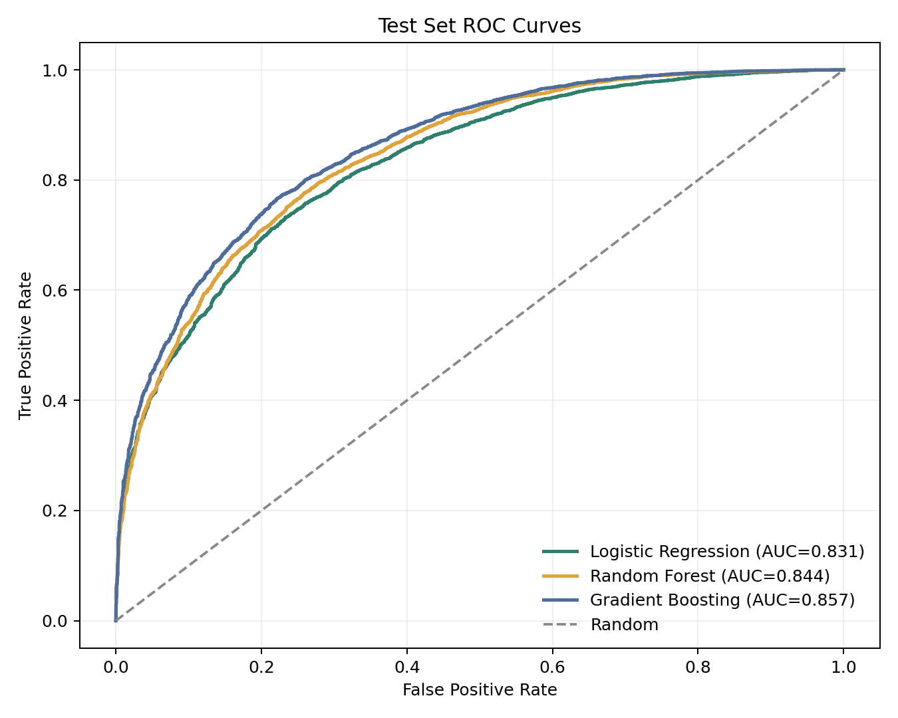
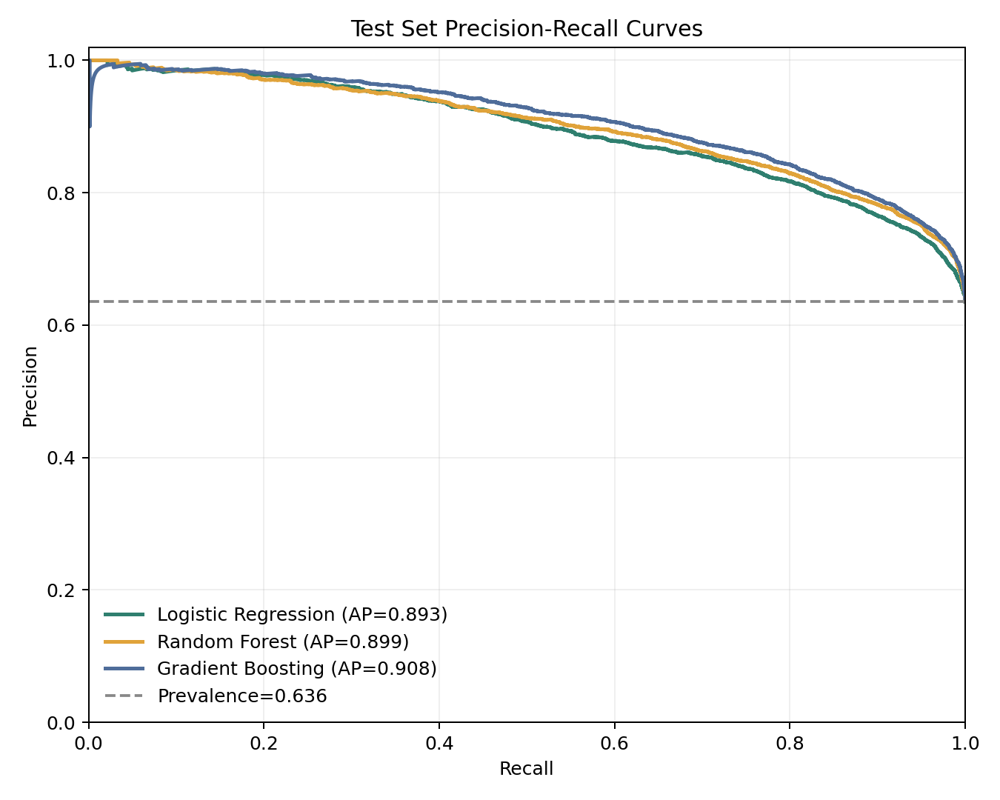
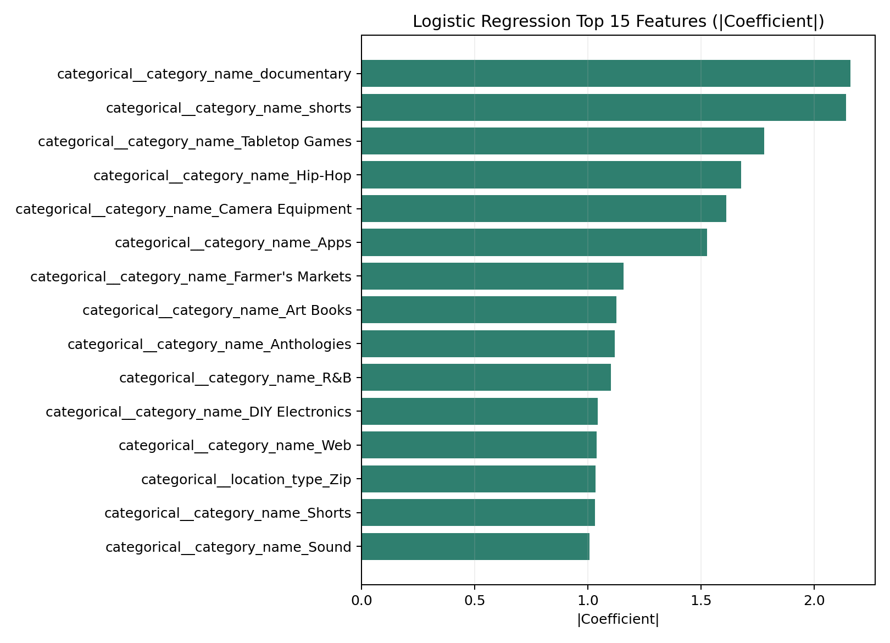
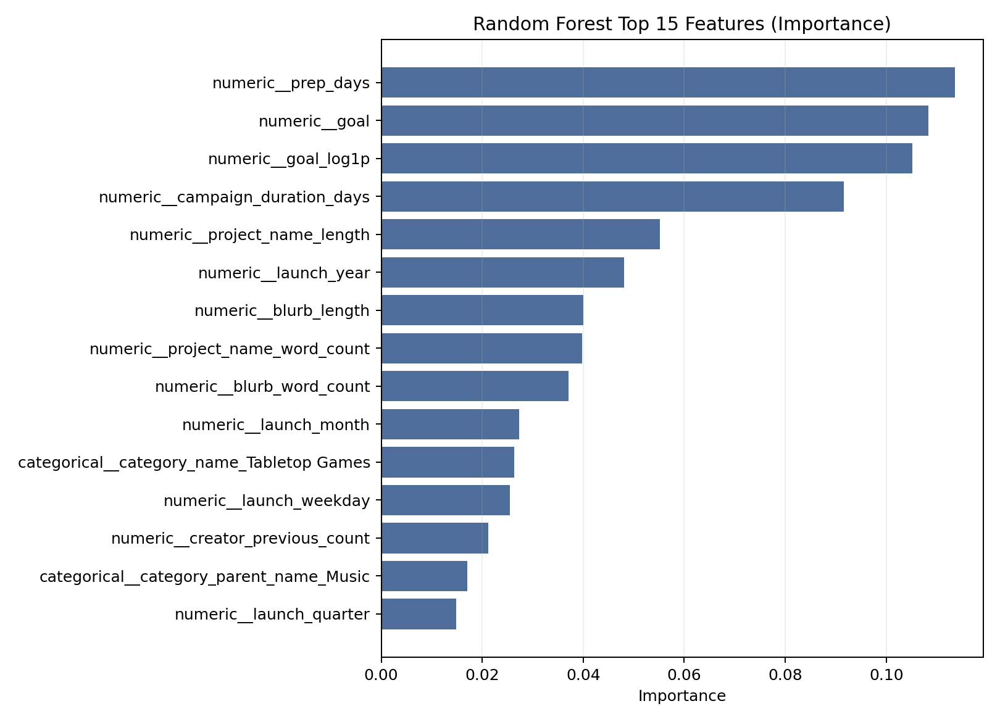
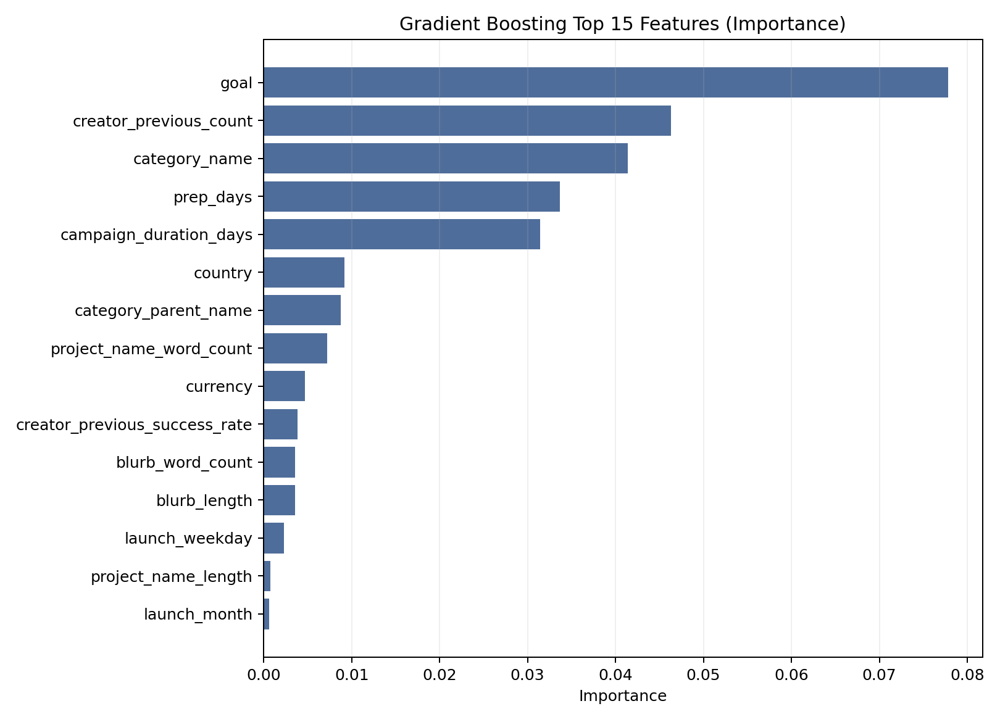
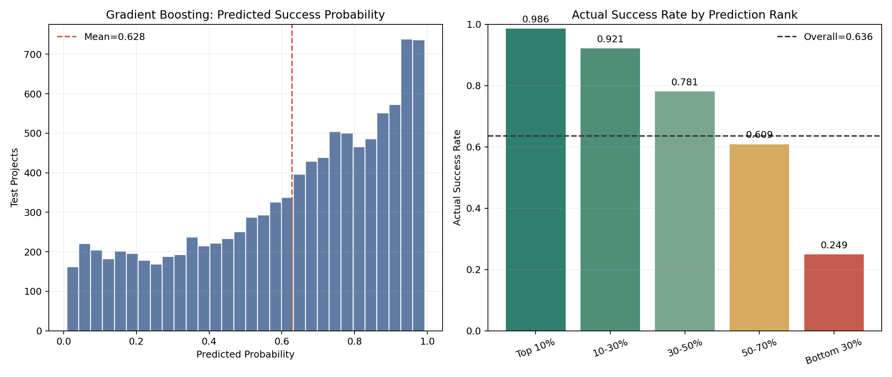
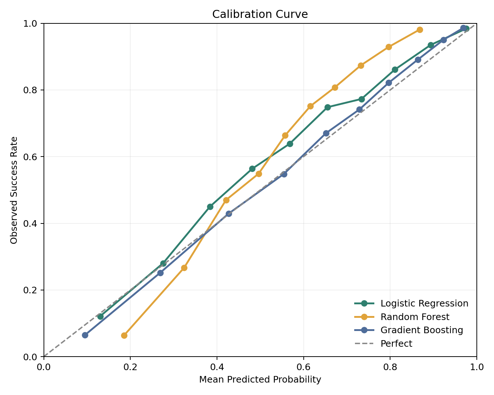

# Kickstarter 项目成功率预测 Pilot Study

## 执行摘要

本报告使用固定 `random_state=42`，从全部 `successful / failed` 项目中分层抽取 10% 建立 Pilot Dataset，并严格按照“项目刚上线时”的预测时点建模。模型不使用 `pledged`、`usd_pledged`、`backers_count`、`percent_funded`、`state_changed_at` 或 `profile_state` 等结果信息。

在测试集上，综合排序能力和 Top-Decile 推荐价值，表现最好的模型是 **Gradient Boosting**。其 ROC-AUC 为 **0.857**，PR-AUC 为 **0.908**，F1 为 **0.844**，Recall 为 **0.921**。相比 Baseline，ROC-AUC 提升 **0.357**，PR-AUC 提升 **0.273**，F1 提升 **0.844**。

测试集总体成功率为 **0.636**；按模型分数选出的预测成功率最高 10% 项目，实际成功率为 **0.986**，Top-Decile Lift 为 **1.552**。因此，推荐决策为：**情况 A：值得继续扩大数据；结果显示出稳定的区分能力和实际的 Top-Decile 推荐价值**。

## 1. 数据与 Pilot Dataset

原始文件规模为 **694,062 行 × 43 列**。状态分布如下：

| state | Projects |
|---|---|
| failed | 307093 |
| successful | 297538 |
| canceled | 69216 |
| submitted | 9469 |
| live | 7474 |
| started | 1920 |
| suspended | 1352 |

只保留 `successful` 与 `failed` 后，使用 `train_test_split(test_size=0.10, stratify=state, random_state=42)` 抽取分层样本。Pilot 样本包含 **60,464 行**，其中成功 **29,754**、失败 **30,710**，成功率为 **49.209%**，与完整有效总体基本一致。

清洗与时间字段检查记录：

- Pilot 初始行数：**60,464**
- 因缺失或异常 `launched_at / deadline` 排除：**0**
- 因项目周期不在 1 至 365 天之间排除：**0**
- 因 `goal` 缺失或为负排除：**0**
- 最终可建模行数：**60,464**

### 数据类型检查

| Column | Pandas_DType | Semantic_Type |
|---|---|---|
| collected_at | int64 | numeric |
| backers_count | int64 | numeric |
| blurb | object | text |
| category_id | float64 | numeric |
| category_name | object | categorical |
| category_parent_id | int64 | numeric |
| category_parent_name | object | categorical |
| category_url | object | categorical |
| converted_pledged_amount | float64 | numeric |
| country | object | categorical |
| created_at | object | datetime |
| creator_id | int64 | numeric |
| creator_name | object | categorical |
| creator_url | object | categorical |
| currency | object | categorical |
| deadline | object | datetime |
| fx_rate | float64 | numeric |
| goal | float64 | numeric |
| id | int64 | numeric |
| launched_at | float64 | datetime |
| location_country | object | categorical |
| location_id | float64 | numeric |
| location_name | object | categorical |
| location_state | object | categorical |
| location_type | object | categorical |
| name | object | text |
| percent_funded | float64 | numeric |
| pledged | float64 | numeric |
| profile_blurb | object | text |
| profile_id | float64 | numeric |
| profile_name | object | categorical |
| profile_project_id | float64 | numeric |
| profile_state | object | categorical |
| profile_state_changed_at | float64 | numeric |
| project_url | object | categorical |
| spotlight | object | boolean |
| staff_pick | object | boolean |
| state | object | categorical |
| state_changed_at | int64 | datetime |
| static_usd_rate | float64 | numeric |
| usd_exchange_rate | float64 | numeric |
| usd_pledged | float64 | numeric |
| usd_type | object | categorical |

### 主要字段缺失值

| Column | Missing_Count | Missing_Rate |
|---|---|---|
| profile_blurb | 590730 | 0.8511 |
| category_id | 131656 | 0.1897 |
| category_name | 131656 | 0.1897 |
| usd_pledged | 11401 | 0.0164 |
| launched_at | 7723 | 0.0111 |
| deadline | 7517 | 0.0108 |

`profile_blurb` 的缺失率极高，且 `category_id / category_name` 等字段存在明显缺失，因此没有把 `profile_blurb` 作为主要预测特征；类别字段缺失统一编码为 `Unknown`，避免删除大量项目。

### 年份分布

| launch_year | Projects | Success_Rate | Cumulative_Share |
|---|---|---|---|
| 2009 | 103 | 0.4854 | 0.0017 |
| 2010 | 962 | 0.4647 | 0.0176 |
| 2011 | 2435 | 0.5146 | 0.0579 |
| 2012 | 3891 | 0.4729 | 0.1222 |
| 2013 | 4211 | 0.4985 | 0.1919 |
| 2014 | 6059 | 0.3680 | 0.2921 |
| 2015 | 6497 | 0.3346 | 0.3995 |
| 2016 | 4995 | 0.3752 | 0.4822 |
| 2017 | 4566 | 0.4286 | 0.5577 |
| 2018 | 3766 | 0.4920 | 0.6200 |
| 2019 | 3639 | 0.5441 | 0.6801 |
| 2020 | 3163 | 0.5757 | 0.7325 |
| 2021 | 3150 | 0.6171 | 0.7845 |
| 2022 | 2895 | 0.6193 | 0.8324 |
| 2023 | 3121 | 0.6280 | 0.8840 |
| 2024 | 3097 | 0.6406 | 0.9353 |
| 2025 | 3202 | 0.6246 | 0.9882 |
| 2026 | 712 | 0.6952 | 1.0000 |

## 2. Data Leakage 检查与预测时点

预测时点定义为：**项目刚刚上线、尚未获得最终融资结果时**。允许使用目标金额、类别、国家、所在地类型、项目名称、简介、计划周期、上线时间和当前项目之前可观察到的发起人历史。禁止使用最终融资结果和项目结束状态。

| 字段 | 处理 | 原因 |
|---|---|---|
| `pledged` | 排除 | 最终融资结果 |
| `usd_pledged` | 排除 | 最终融资结果 |
| `backers_count` | 排除 | 最终支持人数 |
| `percent_funded` | 排除 | 成功结果的直接衍生变量 |
| `state_changed_at` | 排除 | 项目结束时间 |
| `profile_state` | 排除 | 可能与项目结果同步发生 |
| `staff_pick` | 暂不纳入主模型 | 具体授予时间未在数据中说明，标记为 Potential Leakage / Requires Further Verification |
| `spotlight` | 暂不纳入主模型 | 具体生效时间未在数据中说明，标记为 Potential Leakage / Requires Further Verification |
| `creator_previous_*` | 仅使用当前项目之前的历史 | 对发起人的项目按上线时间排序后做累计计算，排除当前和未来项目 |

## 3. 特征工程

数值特征包括 `goal`、`log1p(goal)`、`campaign_duration_days`、准备天数、上线年份/月份/季度/星期、项目名与简介长度/词数，以及发起人历史项目数和历史成功率。类别特征包括一级类别、具体类别、国家、所在地类型和币种。类别变量使用 One-Hot 编码；数值变量使用中位数填补与标准化。

Pilot 阶段没有加入 TF-IDF，原因是任务明确允许在文本处理显著增加复杂度时将其留到第二阶段；本阶段保留了可解释且低成本的文本长度和词数特征。

## 4. 时间切分

按照年份顺序切分，不随机打乱：

- Training：`launch_year <= 2019`，**41,124 行**，成功率 **43.179%**
- Validation：`2020 <= launch_year <= 2022`，**9,208 行**，成功率 **60.361%**
- Test：`launch_year > 2022`，**10,132 行**，成功率 **63.551%**

阈值由验证集 F1 选择，并原样应用到测试集，避免用测试集调参。

## 5. 模型与测试结果

Baseline 为始终采用训练集多数类概率的 Dummy Classifier。正式模型只保留任务指定的 Logistic Regression、Random Forest 与 Gradient Boosting。

| Model | Accuracy | Precision | Recall | F1 | ROC_AUC | PR_AUC | Brier_Score | Threshold |
|---|---|---|---|---|---|---|---|---|
| Gradient Boosting | 0.7829 | 0.7780 | 0.9213 | 0.8436 | 0.8571 | 0.9083 | 0.1453 | 0.4250 |
| Random Forest | 0.7720 | 0.7592 | 0.9391 | 0.8396 | 0.8438 | 0.8987 | 0.1629 | 0.3900 |
| Logistic Regression | 0.7493 | 0.7341 | 0.9495 | 0.8280 | 0.8307 | 0.8927 | 0.1612 | 0.3100 |
| Baseline | 0.3645 | 0.0000 | 0.0000 | 0.0000 | 0.5000 | 0.6355 | 0.2731 | 0.5000 |

各模型的验证集最优 F1 阈值：

| Model | Validation_Optimal_F1_Threshold | Validation_Positive_Rate_At_Threshold |
|---|---|---|
| Logistic Regression | 0.310 | 0.764 |
| Random Forest | 0.390 | 0.741 |
| Gradient Boosting | 0.425 | 0.705 |

### Plot 1：Target Distribution

图中显示 Pilot 样本中成功和失败项目数量接近平衡。该分布使 Accuracy 具有一定参考意义，但模型评价仍以 ROC-AUC、PR-AUC、F1、Recall 和推荐 Lift 为主。

### Plot 2：Model Performance Comparison

三个正式模型的 ROC-AUC 和 F1 均明显高于只输出多数类概率的 Baseline。Gradient Boosting 与 Random Forest 的差距以及 Logistic Regression 的表现，用于判断非线性关系和线性主效应是否都包含有效信号。

### Plot 3：ROC Curve

ROC 曲线衡量模型把成功项目排在失败项目之前的能力。最佳模型的 ROC-AUC 为 **0.857**，相比随机排序的 0.5 有明显提升。

### Plot 4：PR Curve

PR 曲线更直接反映在关注成功项目时的 Precision 与 Recall 权衡。最佳模型的 PR-AUC 为 **0.908**。

### Plot 5：Feature Importance

- **Logistic Regression**: categorical__category_name_documentary, categorical__category_name_shorts, categorical__category_name_Tabletop Games, categorical__category_name_Hip-Hop, categorical__category_name_Camera Equipment, categorical__category_name_Apps, categorical__category_name_Farmer's Markets, categorical__category_name_Art Books
- **Random Forest**: numeric__prep_days, numeric__goal, numeric__goal_log1p, numeric__campaign_duration_days, numeric__project_name_length, numeric__launch_year, numeric__blurb_length, numeric__project_name_word_count
- **Gradient Boosting**: goal, creator_previous_count, category_name, prep_days, campaign_duration_days, country, category_parent_name, project_name_word_count

完整的 Top 15 图如下：

- [Logistic Regression 系数图](plots/05_feature_importance_logistic_regression.png)
- [Random Forest 特征重要性图](plots/06_feature_importance_random_forest.png)
- [Gradient Boosting 置换重要性图](plots/07_feature_importance_gradient_boosting.png)

这些结果说明哪些变量在当前模型中贡献了预测信息。它们不代表因果影响，不能据此声称某个字段会导致项目成功。

### Plot 6：Predicted Success Probability

左图展示测试项目预测概率的分布；右图把项目按预测成功率排序，并比较不同排名区间的真实成功率。该图直接对应“有限辅导资源应优先投向哪些项目”的运营场景。

最佳模型按预测排名分组的测试结果：

| Group | Projects | Actual_Success_Rate | Mean_Predicted_Probability | Rank_Start | Rank_End |
|---|---|---|---|---|---|
| Top 10% | 1014 | 0.9862 | 0.9689 | 1 | 1014 |
| 10-30% | 2026 | 0.9210 | 0.8937 | 1015 | 3040 |
| 30-50% | 2026 | 0.7813 | 0.7625 | 3041 | 5066 |
| 50-70% | 2027 | 0.6088 | 0.6029 | 5067 | 7093 |
| Bottom 30% | 3039 | 0.2488 | 0.2637 | 7094 | 10132 |

### Top-Decile Lift

| Test_Projects | Top_Projects | Overall_Success_Rate | Top_Decile_Success_Rate | Top_Decile_Lift | Captured_Successes_Share | Model |
|---|---|---|---|---|---|---|
| 10132 | 1014 | 0.6355 | 0.9842 | 1.5487 | 0.1550 | Logistic Regression |
| 10132 | 1014 | 0.6355 | 0.9813 | 1.5441 | 0.1545 | Random Forest |
| 10132 | 1014 | 0.6355 | 0.9862 | 1.5518 | 0.1553 | Gradient Boosting |

Top-Decile Lift 为 **1.552**。这意味着模型选出的最高 10% 项目的实际成功率约为测试集总体成功率的 **1.55 倍**。

### Calibration

| Model | Brier_Score |
|---|---|
| Logistic Regression | 0.1612 |
| Random Forest | 0.1629 |
| Gradient Boosting | 0.1453 |

校准图用于检查预测概率是否接近实际发生率。Brier Score 越低越好。若曲线偏离对角线明显，则成功概率应主要用于项目排序，而不是直接解释为经过校准的真实成功概率。

## 6. 稳定性检查

为降低单个时间切分带来的偶然性，本实验在严格按时间排序的数据上增加 3 个 expanding-window time folds。每个 fold 只使用过去数据训练、较晚数据测试。

| Fold | Model | Train_Rows | Test_Rows | Train_End | Test_Start | Test_End | Accuracy | Precision | Recall | F1 | ROC_AUC | PR_AUC |
|---|---|---|---|---|---|---|---|---|---|---|---|---|
| 1 | Logistic Regression | 15116 | 15116 | 2014-08-09 05:19:54+00:00 | 2014-08-09 09:22:00+00:00 | 2017-03-22 14:13:51+00:00 | 0.6936 | 0.6075 | 0.4060 | 0.4867 | 0.7188 | 0.5763 |
| 1 | Random Forest | 15116 | 15116 | 2014-08-09 05:19:54+00:00 | 2014-08-09 09:22:00+00:00 | 2017-03-22 14:13:51+00:00 | 0.7049 | 0.6565 | 0.3679 | 0.4716 | 0.7480 | 0.6066 |
| 1 | Gradient Boosting | 15116 | 15116 | 2014-08-09 05:19:54+00:00 | 2014-08-09 09:22:00+00:00 | 2017-03-22 14:13:51+00:00 | 0.7089 | 0.6427 | 0.4200 | 0.5081 | 0.7615 | 0.6308 |
| 2 | Logistic Regression | 30232 | 15116 | 2017-03-22 14:13:51+00:00 | 2017-03-22 15:33:33+00:00 | 2021-04-24 20:05:55+00:00 | 0.6500 | 0.7792 | 0.4520 | 0.5721 | 0.7643 | 0.7668 |
| 2 | Random Forest | 30232 | 15116 | 2017-03-22 14:13:51+00:00 | 2017-03-22 15:33:33+00:00 | 2021-04-24 20:05:55+00:00 | 0.6725 | 0.7934 | 0.4967 | 0.6109 | 0.7894 | 0.7914 |
| 2 | Gradient Boosting | 30232 | 15116 | 2017-03-22 14:13:51+00:00 | 2017-03-22 15:33:33+00:00 | 2021-04-24 20:05:55+00:00 | 0.7036 | 0.7577 | 0.6283 | 0.6870 | 0.7962 | 0.7997 |
| 3 | Logistic Regression | 45348 | 15116 | 2021-04-24 20:05:55+00:00 | 2021-04-25 00:21:34+00:00 | 2026-04-15 15:59:02+00:00 | 0.7552 | 0.7820 | 0.8462 | 0.8128 | 0.8218 | 0.8836 |
| 3 | Random Forest | 45348 | 15116 | 2021-04-24 20:05:55+00:00 | 2021-04-25 00:21:34+00:00 | 2026-04-15 15:59:02+00:00 | 0.7728 | 0.7916 | 0.8662 | 0.8272 | 0.8388 | 0.8908 |
| 3 | Gradient Boosting | 45348 | 15116 | 2021-04-24 20:05:55+00:00 | 2021-04-25 00:21:34+00:00 | 2026-04-15 15:59:02+00:00 | 0.7837 | 0.7843 | 0.9045 | 0.8401 | 0.8542 | 0.9015 |

如果不同 fold 的 ROC-AUC 波动明显，说明时间漂移是第二阶段必须重点处理的问题。

## 7. 是否值得继续：Pilot 决策

决策结果：**情况 A：值得继续扩大数据；结果显示出稳定的区分能力和实际的 Top-Decile 推荐价值**。

判断依据如下：

1. **Predictive Performance**：最佳模型 ROC-AUC = 0.857，PR-AUC = 0.908，F1 = 0.844，Recall = 0.921。
2. **Improvement over Baseline**：ROC-AUC 提升 0.357，PR-AUC 提升 0.273，F1 提升 0.844。
3. **Recommendation Value**：Top 10% 实际成功率为 0.986，总体为 0.636，Lift 为 1.552。
4. **Leakage Control**：结果变量和未知时间属性的平台推荐字段已排除或延后验证。
5. **Stability**：稳定性结果见上文多个时间 fold；后续应继续观察时间漂移。

该判断不使用人为设定的固定及格线，而是综合区分能力、基线提升、推荐价值和稳定性决定。

## 8. Expected Research Output

### Academic / Research Output

- 上线时项目成功预测模型与可复现实验管线
- 特征重要性及非线性关系分析
- 项目成功概率评分
- Goal、上线时间、品类、国家与成功率关系
- 发起人历史与当前项目成功关系

### Business Output

- 项目优先推荐名单
- 高风险项目预警
- 创作者辅导名单
- 推荐资源分配依据
- 平台运营策略

### Visualization Output

- Target Distribution
- Model Comparison
- ROC Curve
- PR Curve
- Feature Importance
- Success Probability Distribution
- Top-Decile Lift / Success Rate

## 9. 第二阶段建议

只有在 Pilot 结果支持继续时才扩大数据。第二阶段应使用完整有效项目，加入 TF-IDF 文本特征，改进发起人历史特征，进行更严格的多窗口时间验证，并检查不同年份、品类和国家的模型表现。最终可以基于模型概率建立高潜项目优先推荐名单和风险预警名单。

## 10. 局限性

- **Dataset Bias**：Kickstarter 数据不能代表所有众筹平台。
- **Selection Bias**：`staff_pick`、`spotlight` 与平台资源分配相关，可能存在选择偏差和反向因果。
- **Temporal Drift**：不同年份的项目构成、成功率和平台规则发生变化。
- **Missing Values**：`profile_blurb`、`category_id / category_name` 等字段缺失明显。
- **Result Leakage**：已明确排除最终融资类字段和结束时间字段。
- **Prediction vs Causality**：模型特征重要性只反映预测贡献，不能解释为因果关系。
- **Pilot Sampling**：发起人历史特征只基于 10% Pilot 样本计算，历史项目可见度不完整；第二阶段应基于完整有效数据重新构造。

## 11. 核心问答

**在完全不使用项目最终结果信息的前提下，Kickstarter 的项目早期信息能否帮助识别更值得优先推荐或辅导的项目？**

根据本次真实 Pilot 结果，最佳模型为 **Gradient Boosting**，测试集 ROC-AUC 为 **0.857**，PR-AUC 为 **0.908**，Top-Decile Lift 为 **1.552**。因此，早期信息包含可用于排序的预测信号，模型适合作为决策辅助工具；但不能把预测概率解释为成功保证或因果结论。
