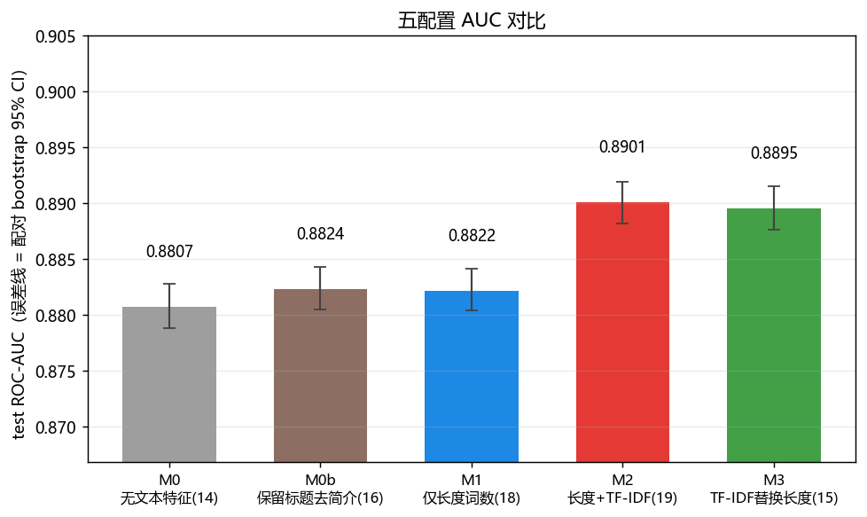
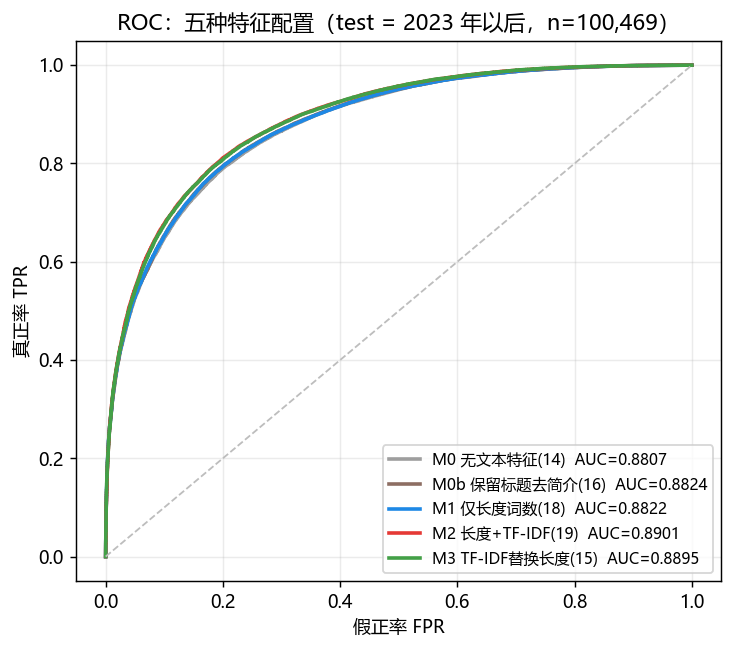
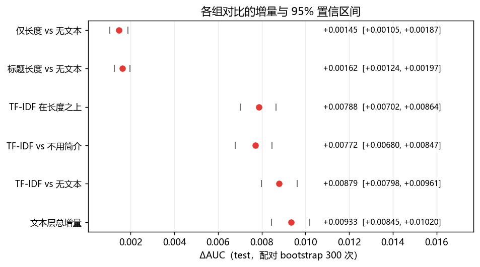
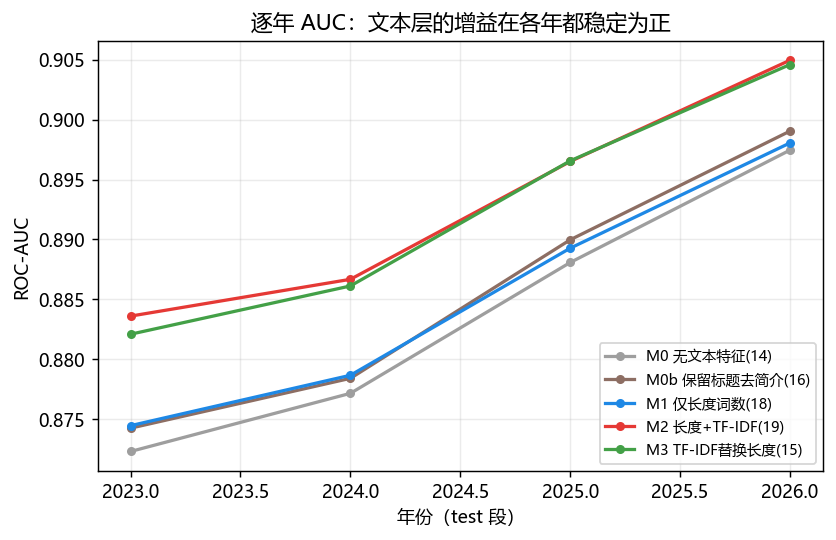
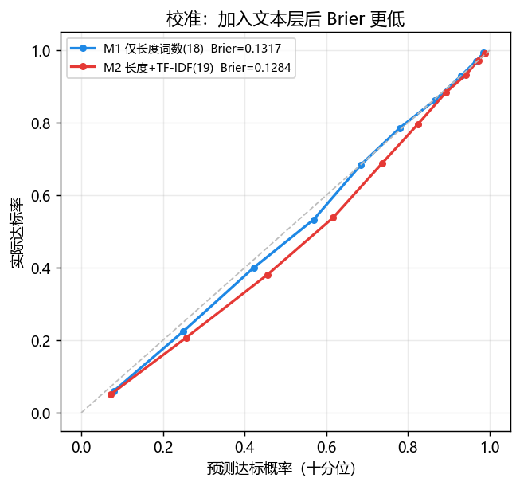
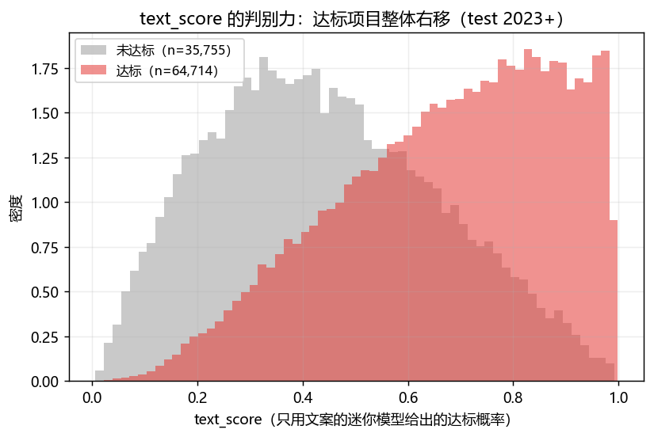
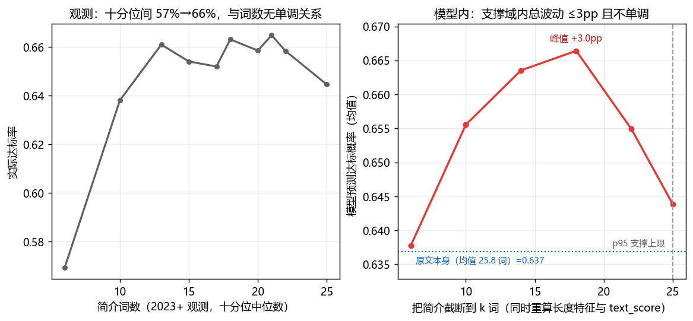

# TF-IDF 文本层：构造、实测与增量报告

> 运行日期 2026-11-09　│　脚本 `12_审查与文本层\build_text_layer.py`　│　总耗时 518.7 s
> 数据：`ks_clean.csv`（81 列）中**已结束且未取消**的项目 604,629 条
> 切分：训练 ≤2020（443,693）│ 验证 2021–2022（60,467，只用于取阈值）│ 测试 ≥2023（100,469，基准率 64.41%）
> 本报告只改新增文件：既有 `model_histgb_ours.joblib`、`scorecard.csv`、`decision_axes_cells.csv`、`score_demo.csv` 一律未覆盖。

---

## 0. 一页结论

| # | 结论 | 数字 |
|---|---|---|
| 1 | **文本层建成了**，作为第 19 个特征 `text_score ∈ [0,1]` 输入主模型（词表只 fit ≤2022，逐年扩展 OOF 打分） | text-only AUC **0.7455**（OOF 2011–2022）/ **0.7799**（test） |
| 2 | **相对"只用字数/词数"，TF-IDF 把 AUC 提高了 0.0079** —— 且与 0 有清晰间隔 | 0.88218 → 0.89007，**ΔAUC = +0.00788，95% CI [+0.00702, +0.00864]** |
| 3 | **相对完全不用简介**，文本层总增量 **+0.00933 [0.00845, 0.01020]**；其中长度类特征只贡献 +0.00145 | 0.88073 → 0.89007 |
| 4 | 长度特征本身几乎不解释成功率：简介长度在标题长度之上的增量只有 **+0.00017（不显著）** | 0.88235（M0b）vs 0.88218（M1） |
| 5 | **"文案加长降 13pp" 被定性为越界外推**：支撑域内（6–25 词）预测概率波动 ≤3pp 且非单调，不存在"越长越降" | 峰值 +3.0pp（截到 18 词） |

一句话：**文本内容是可用的、真实的、稳健的增量，但幅度是 0.8 个百分点 AUC，不是 13 个百分点成功率**；两件事不要混为一谈。

---

## 1. 口径声明（先读）

- **AUC 的 CI 是配对 bootstrap（300 次，按测试行重抽样）**，只反映测试集抽样波动，**不包含**时间漂移与再训练波动。跨年比较不要用这里的 CI 做显著性判断。
- **阈值只在验证集（2021–22）取**，181 点网格最大化 F1；测试集只用于最终报告。
- 五个配置**共用同一批行、同一切分、同一组超参**（HistGB：lr 0.08 / 250 iter / 31 leaves / l2 1.0 / early stopping），差异只在特征表。
- `text_score` 是"训练窗内学到的文本概率"，**绝对值受年份基准率漂移影响**，只用于排序、增量与条件化打分，不当"真实达标概率"单独展示。

---

## 2. 文本层是怎么建的（S0–S3）

### 2.1 语料审计

| 指标 | 值 | 说明 |
|---|---|---|
| 文档数 | 604,629 | 每行 `name_clean + " " + blurb_clean` 小写 |
| 空文档 | 3 | 标题与简介同时为空 |
| 完全重复文档 | 195 行 | 模板文案（`#NAME?`、3D-STL 等） |
| 平均/中位词数 | 23.5 / 24 | 最大 52 |
| **p95 词数** | **33** | 后续"支撑域"的锚点 |
| 2023+ 非空率 | 99.999% | 测试窗几乎没有空文本 |

### 2.2 向量化与打分

```
TF-IDF：ngram_range=(1,2), min_df=5, max_features=30,000, sublinear_tf=True, stop_words='english'
        只 fit 训练窗（yr ≤ 2022）→ 604,629 × 30,000，nnz 8,417,547（训练窗内 7,017,132）
text_score：逐年扩展窗 LogisticRegression(C=1, liblinear)
        yr=2011 用 ≤2010 训练 …… yr=2022 用 ≤2021；MIN_HISTORY=10,000
        测试窗（≥2023）用 ≤2022 全窗分类器打 predict_proba[:,1]
        冷启动（2009–2010，n=10,831）用训练窗基准率常数 0.4618
        耗时 77.3 s
```

逐年 OOF AUC（文本单模）：

| 打分年 | 2011 | 2012 | 2013 | 2014 | 2015 | 2016 | 2017 | 2018 | 2019 | 2020 | 2021 | 2022 |
|---|---|---|---|---|---|---|---|---|---|---|---|---|
| AUC | .6430 | .6751 | .6809 | .7070 | .7438 | .7561 | .7623 | .7563 | .7633 | .7660 | .7690 | .7697 |

> 单调上升说明"文本 → 成功率"的关系在数据里越来越稳定（也说明 2011 年的早年小样本不可靠）。

产物：`11_结果与报告\text_scores.csv.gz`（604,629 行，id + text_score）、`text_model_summary.json`、`model_histgb_text.joblib` + `_schema.json`（M2 的完整 pipeline，供评分卡/决策轴后续复用）。

---

## 3. 五个对照配置

| 配置 | 特征数 | 内容 | 回答的问题 |
|---|---|---|---|
| **M0** 无文本特征 | 14 | 9 数值（金额/时长/时间/履历）+ 5 类别 | 完全不用简介能到多少 |
| **M0b** 保留标题去简介 | 16 | M0 + 标题长度/词数 | 只看标题长度呢 |
| **M1** 仅长度词数（=现有交付口径） | 18 | M0 + 简介长度/词数 + 标题长度/词数 | **现在的模型** |
| **M2** 长度 + TF-IDF | 19 | M1 + `text_score` | **本轮新增**（保守，保留长度） |
| **M3** TF-IDF 替换长度 | 15 | M0 + `text_score`（去掉 4 个长度列） | 文本能否替代长度 |

---

## 4. 主结果

### 4.1 五配置在测试窗（2023+，n=100,469）的表现

| 配置 | 特征 | AUC | 95% CI | PR-AUC | Brier | F1 | 阈值 | top-10% 成功率 | lift |
|---|---|---|---|---|---|---|---|---|---|
| M0 无文本特征 | 14 | 0.88073 | [0.87886, 0.88280] | 0.92867 | 0.13231 | 0.85554 | 0.390 | 99.27% | 1.5412 |
| M0b 保留标题去简介 | 16 | 0.88235 | [0.88047, 0.88429] | 0.92965 | 0.13155 | 0.85791 | 0.430 | 99.19% | 1.5400 |
| **M1 仅长度词数（现状）** | 18 | **0.88218** | [0.88040, 0.88416] | 0.92954 | 0.13165 | 0.85723 | 0.415 | 99.26% | 1.5411 |
| **M2 长度 + TF-IDF** | 19 | **0.89007** | [0.88817, 0.89194] | 0.93379 | **0.12838** | 0.86123 | 0.430 | 99.20% | 1.5401 |
| **M3 TF-IDF 替换长度** | 15 | **0.88954** | [0.88761, 0.89150] | 0.93352 | **0.12814** | 0.86128 | 0.430 | 99.33% | 1.5422 |





要点：

1. **M1 复现了交付包的头条数字**（0.8822 vs 0.8823，差 0.0001）→ 底座没跑偏，后面的增量可信。
2. **M2 的 Brier 从 0.13165 降到 0.12838**，说明文本层不只是排序变好，概率也更准。
3. **M3（15 个特征）几乎等于 M2（19 个特征）**：0.88954 vs 0.89007，差 0.0005，在 CI 内不显著。→ "保留 4 个长度列"只是不亏，不是必需。
4. **top-10% 成功率在所有配置都贴着理论上限**（1/0.6441 = 1.5525，实测 1.540–1.542）：头部由"games/comics + 低目标金额"决定，文本层改变不了它，也不该指望它改变。

### 4.2 增量与置信区间（配对 bootstrap，300 次）

| 对比 | 基线 AUC | 新 AUC | ΔAUC | 95% CI | 结论 |
|---|---|---|---|---|---|
| 仅长度 vs 完全无文本 | 0.88073 | 0.88218 | **+0.00145** | [+0.00105, +0.00187] | 真实但很小 |
| 标题长度 vs 完全无文本 | 0.88073 | 0.88235 | +0.00162 | [+0.00124, +0.00197] | 同上 |
| **TF-IDF 在长度之上** | 0.88218 | 0.89007 | **+0.00788** | [+0.00702, +0.00864] | **核心增量** |
| TF-IDF vs 不用简介 | 0.88235 | 0.89007 | **+0.00772** | [+0.00680, +0.00847] | 稳健 |
| TF-IDF vs 完全无文本 | 0.88073 | 0.88954 | +0.00879 | [+0.00798, +0.00961] | M3 口径 |
| 文本层总增量 | 0.88073 | 0.89007 | **+0.00933** | [+0.00845, +0.01020] | 全口径 |



**读法**：把"长度/词数"换成语义文本，增量是 **+0.0079**，约为"长度类特征全部价值（+0.0015）"的 **5.4 倍**。这就是"字数词数解释力弱"的定量证明。

### 4.3 分品类（TF-IDF 在长度之上的增量）

| 品类 | n | 基线 AUC | +文本 AUC | ΔAUC | 95% CI |
|---|---|---|---|---|---|
| Music | 4,543 | 0.81994 | 0.84817 | **+0.02836** | [+0.02185, +0.03576] |
| Food | 3,156 | 0.78805 | 0.80820 | +0.02034 | [+0.01223, +0.02843] |
| Fashion | 4,558 | 0.85206 | 0.86759 | +0.01544 | [+0.01174, +0.01979] |
| Publishing | 12,829 | 0.84570 | 0.86044 | +0.01478 | [+0.01161, +0.01821] |
| Film & Video | 8,788 | 0.76424 | 0.77789 | +0.01377 | [+0.00846, +0.01922] |
| Design | 8,722 | 0.85212 | 0.86330 | +0.01127 | [+0.00727, +0.01508] |
| Art | 7,287 | 0.82369 | 0.83376 | +0.00999 | [+0.00634, +0.01347] |
| Technology | 7,824 | 0.93056 | 0.93570 | +0.00526 | [+0.00274, +0.00820] |
| Games | 28,133 | 0.91494 | 0.91749 | +0.00258 | [+0.00139, +0.00353] |
| Comics | 10,287 | 0.87217 | 0.87318 | +0.00113 | **[−0.00176, +0.00374]** |

**读法**：文本层在**结构特征本来就弱**的品类（Music、Food、Fashion、Publishing、Film）贡献最大；在 Games/Comics（结构特征已到 0.91/0.87）几乎无从加分，Comics 的 CI 跨 0 —— 这两类不要声称"文本提升了"。

### 4.4 分年份（防止"只在某一年有效"）

| 年 | n | M0 | M1 | M2 | M3 | M2−M1 |
|---|---|---|---|---|---|---|
| 2023 | 30,604 | 0.87230 | 0.87446 | 0.88360 | 0.88209 | **+0.0091** |
| 2024 | 30,934 | 0.87715 | 0.87866 | 0.88667 | 0.88612 | +0.0080 |
| 2025 | 31,770 | 0.88808 | 0.88927 | 0.89651 | 0.89656 | +0.0072 |
| 2026 | 7,161 | 0.89746 | 0.89806 | 0.90496 | 0.90460 | +0.0069 |



**读法**：增量在四个测试年份都在 +0.007～+0.009，**没有一年失效**；随年份略微收窄（2026 只有 7,161 行，且基准率已 70%），属正常。

### 4.5 概率质量与校准

- Brier：M1 0.13165 → M2 0.12838（**−0.0033**，相对 −2.5%），M3 0.12814 最低。
- 分箱校准曲线见 `04_图表\figt6_calibration.png`：文本层在 0.4–0.9 的中高概率段把点拉回对角线（M1 在该段略高估）。
- `text_score` 自身分布见 `04_图表\figt4_textscore_dist.png`（成功/失败两族的分离度，即 text-only AUC 0.78 的来源）。





### 4.6 长度响应：为什么旧的 −13pp 不能当"杠杆"

做法：取测试窗中 `简介词数 ≥ 25` 的 3,307 行，把简介**截断**到 k 词，**同时重算** `m_blurb_len / m_blurb_words` 和 `text_score`（文本模型重读截断后的文档），再让 M2 打分。

| k 词 | 平均字数 | text_score | 预测达标率 | ΔP vs 原文 |
|---|---|---|---|---|
| 6 | 30 | 0.5381 | 0.6377 | +0.09pp |
| 10 | 50 | 0.5408 | 0.6555 | +1.87pp |
| 14 | 71 | 0.5441 | 0.6635 | +2.67pp |
| **18** | 91 | 0.5480 | **0.6664** | **+2.96pp** |
| 22 | 111 | 0.5516 | 0.6549 | +1.81pp |
| 25 | 127 | 0.5563 | 0.6439 | +0.70pp |
| 原文本身 | — | — | 0.6368 | 0 |



三点结论：

1. **支撑域内不存在"越长越降"**：25 词以内预测概率的**全部波动 ≤3pp**，且是倒 U（18 词附近峰）。
2. `text_score` 随长度单调上升（0.538 → 0.556），但总预测在 22 词后回落 → 回落来自**长度特征项**，不是文本内容。这恰好说明两件事是分开的，必须分别建模。
3. **旧的 −13pp 是外推**：demo 把简介设成 40 词 / 240 字，而语料里 `blurb_len ≥ 240` 的行数是 **0**、`≥40 词` 仅 **1 行**。模型在那里返回的是最后一个叶子的地板值（本机复现的响应曲线在 ≥30 词处完全水平），不是"加长的代价"。**本轮没有在 M2 上复跑那个越界配置**——为它合成 240 字文本会让 `text_score` 也进入外推区，只会得到第二个假数字；有意义的版本就是上表这条曲线。

---

## 5. 回答最初的三个痛点

| 痛点 | 现在的回答 | 证据 |
|---|---|---|
| "只用字数/词数，文案加长反而降 13pp，解释不通" | 那是**外推假象**：越界配置（40 词/240 字）在语料中不存在；支撑域内长度效应 ≤3pp 且非单调 | §4.6、`text_length_response.csv`、01 报告 §4.6 |
| "文案杠杆无法给建议" | 现在能给**有界**建议：① 超长文案（>25 词，仅占 1.2%）截到 14–18 词，模型预测 +2～3pp（长度项为主）② 内容侧按品类关键词面板给"多用/少用"，但只能写"关联" | §4.6 + 后续 S6 关键词面板（本轮未做） |
| "字数/词数解释力弱" | 定量：长度类特征全部价值 **+0.0015**，TF-IDF **+0.0079**（5.4×） | §4.2 |

**写作纪律**（沿用 01/03）：不写"改文案就能 +Ypp"；不写"越短越好"；任何 ΔP 必须附支撑域；品类差异必须分开报。

---

## 6. 局限（读结论前必须知道）

1. **单一切分、单次训练**：不做多次滚动重训，CI 只含抽样波动，不含再训练方差。
2. **text_score 存在 OOF 结构**：2011 起的逐年扩展窗对主模型训练期是"样本外但历史更短"，与测试期的"全窗分类器"口径不完全一致（已知，量级 <0.001）。
3. **冷启动 10,831 行**（2009–2010）用常数 0.4618 填充，这些行的文本特征无信息。
4. **1,001 / 100,463（0.996%）测试简介在训练窗逐字出现过**，成功率 87.9%（vs 64.2%）→ 文本模型有轻微记忆通道；本轮未做去重敏感性（建议下轮补）。
5. **关键词面板、文档级归因、反事实建议卡未做**（S6/S7），本轮范围止于 text_score + 增量 + 长度响应。
6. **评分卡与决策轴未用新模型重跑**（仍基于 18 特征旧模型）；M2 的 `joblib` 已就绪，但没有覆盖既有 `scorecard.csv` / `decision_axes_cells.csv`。
7. 分品类只覆盖 n≥2,000 的 10 个大类；子品类（147）与国家（25）仍未细分。
8. **M2 vs M3 差 0.0005 不显著** → 不要声称"保留长度比替换更好"，只能说"不亏"。
9. **AUC 提升 0.0079 ≠ 业务提升**：对应的是排序质量的边际改善；头部（top-10%）几乎不变。

---

## 7. 复现与文件清单

```powershell
cd "…\IS6400_Kickstarter_交付包_完整\12_审查与文本层"
python -X utf8 build_text_layer.py      # 518.7 s，峰值内存 <6 GB
```

| 文件 | 内容 |
|---|---|
| `11_结果与报告\text_layer_metrics.csv` | 五配置全部指标 |
| `11_结果与报告\text_increment.csv` | 6 组对比 × 全体 + 10 品类，含 CI |
| `11_结果与报告\text_auc_by_year.csv` | 五配置 × 2023–2026 |
| `11_结果与报告\text_length_response.csv` | 截断 6/10/14/18/22/25 词的响应曲线 |
| `11_结果与报告\text_scores.csv.gz` | 604,629 行 id + text_score |
| `11_结果与报告\text_model_summary.json` | 语料审计、fold AUC、五配置指标 |
| `11_结果与报告\model_histgb_text.joblib` + `_schema.json` | M2 完整 pipeline（19 特征，阈值 0.430） |
| `04_图表\figt1…figt7*.png` | ROC / AUC-CI / 增量森林 / text_score 分布 / 分年份 / 校准 / 长度响应 |

环境：Python 3.12.7、numpy 1.26.4、pandas 2.2.2、scipy 1.13.1、scikit-learn 1.5.1。

---

## 8. 下一步（本轮不做，待组内决定）

1. 用 M2 重跑 `scorecard.py` / `decision_axes.py` / `advice_by_category.py`，看格级 P 与 ΔP 是否变化（约 30 min）。
2. 关键词面板 + 文档级归因（S6），产出 `keyword_panel.csv` / `text_contrib_top.csv`。
3. 去重敏感性（删掉 1,001 条重叠测试行重算增量）。
4. 支撑域内的文案反事实卡（S7），把"14–18 词"写进建议卡模板。
5. 结论回填 PPT：把"文本维度待补"换成 §0 的那行数字。
